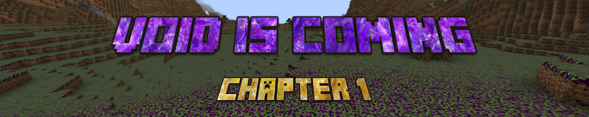
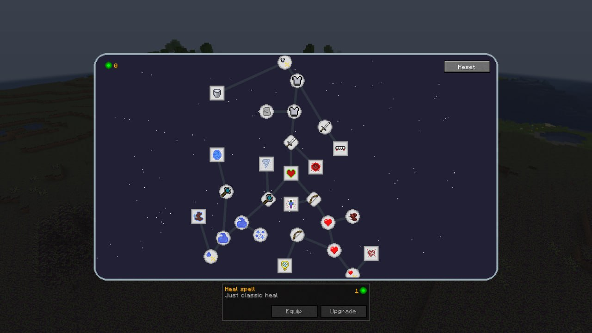
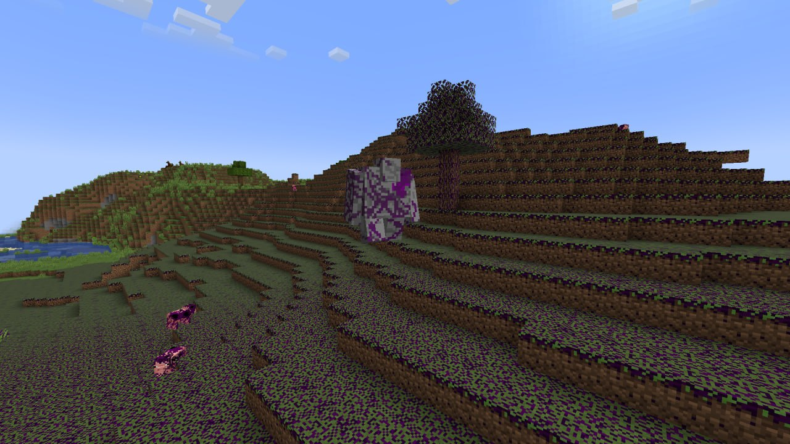
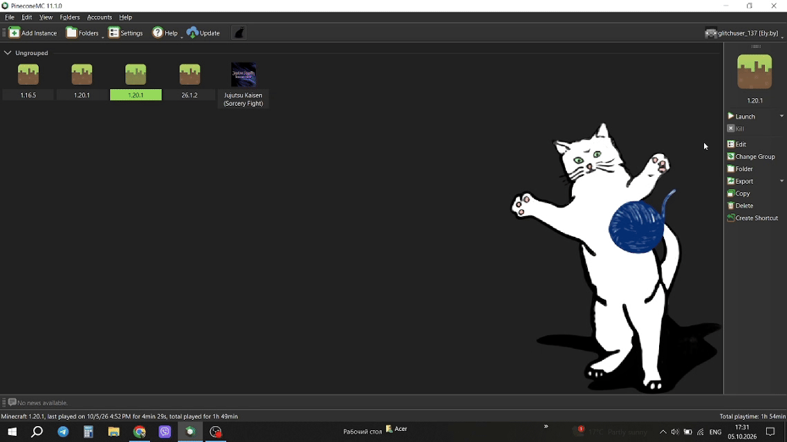
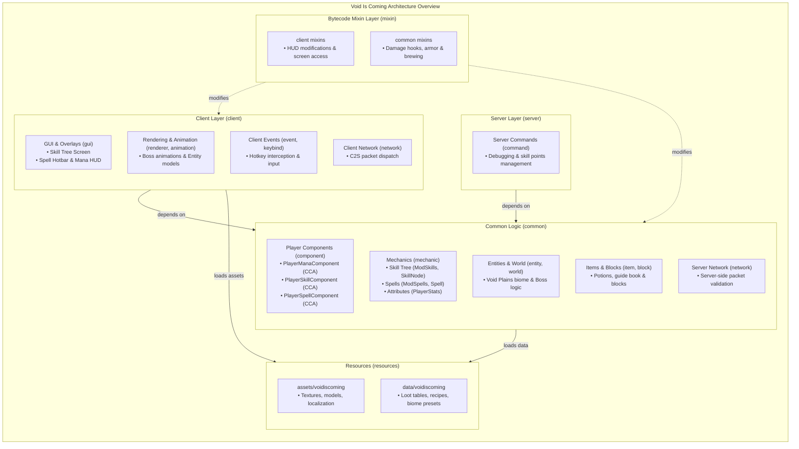

**English** | [Українська](README.uk.md)



# Void Is Coming

**A hardcore RPG overhaul for Minecraft: choose a class, grow through a skill tree, cast spells with mana, and face the creatures of the Void Plains.**

   


## The Idea

Vanilla Minecraft progression is mostly about better materials. **Void Is Coming** adds a second layer: your character grows too. Your combat, movement and magic are shaped by the class you choose and the skills you unlock, so two players with the same gear can play very differently.

- **Progression you choose.** Pick a path through the skill tree: Warrior, Archer or Mage.
- **Levels give you skill points.** Every level-up rewards points you spend on new skills.
- **Spells with a cost.** Equip spells and manage your mana during fights.
- **One system for everything.** Swords, bows and spells all scale from the same skill and stat system, which keeps the game consistent and easy to extend.
- **Hardcore survival.** There is no passive regeneration, and the Void creatures are much harder than vanilla mobs, so every fight and every potion matters.

## Features

### Classes and skill tree



A node-based skill tree branching into three distinct specializations:

- **Skill point progression**: Every player level-up grants skill points (`Skill Points`) to invest in the skill tree.
- **Tree structure**: Features foundational nodes, specialization choices, passive attribute modifiers, and spell unlocks.
- **Three mutually exclusive classes**: Selecting one specialization locks the other two paths:
  - **Warrior**: Specializes in heavy armor efficiency, damage resilience (`Resilience`), melee weapon scaling, and sustained close-quarters combat.
  - **Archer**: Focuses on maximum health growth, movement speed bonuses, ranged bow mastery, stealth, and tactical field awareness.
  - **Mage**: Emphasizes mana capacity scaling, magical affinity (`Affinity`), spatial mobility, crowd control, and protective shields.
- **Skill reset**: Players can freely reset their skill tree at any time via the GUI, refunding all spent points to adapt their build.

### Mana system

Mana is the fundamental resource governing magical abilities:

- **Base capacity and dynamic scaling**: Players start with a base pool of 20 mana. Maximum mana scales dynamically with Mage progression and dedicated mana capacity modifiers.
- **Magical affinity (`Affinity`)**: A dedicated attribute that reduces the resource cost of spells, optimizing cast efficiency.
- **HUD integration**: Real-time mana status is clearly displayed on a custom HUD bar positioned alongside health and armor indicators.
- **Restoration**: Mana is replenished through craftable mana potions of varying potency.

### Spells and combat abilities

A comprehensive magic subsystem integrating active tactical skills and condition-based passives:

- **Spell hotbar**: A dedicated interface with customizable active slots (2 initially, expandable up to 4).
- **Seamless casting**: Spells are bound to dedicated hotkeys for immediate tactical execution during combat.
- **Resource cost and cooldowns**: Spells consume mana (`MANA`), health (`HP`), or function passively (`NONE`), balanced by cooldown timers. Dedicated passives enable systematic cooldown reduction.
- **Ability categories**:
  - **Active tactical spells**: Direct healing, instantaneous spatial relocation, area-of-effect freezing bursts inflicting slowness and freeze ticks, combat battle states, and harmful effect dispelling.
  - **Passive and triggered abilities**: Conditional effects activating upon eliminating foes, sustaining full mana capacity, or mitigating critical damage thresholds.

### The Void Plains and its creatures



A distinct biome featuring custom flora and a desolate atmosphere, inhabited by mutated Void fauna and guarded by the Stone Golem boss mob. Entity behaviors and attributes are balanced to rigorously test character builds.

### Additional features

- **Custom entity attributes**: Dynamic recalculation of max health, armor, movement speed, mana, and attack damage.
- **Consumables**: Tiered healing and mana restoration potions.
- **Custom user interface**: Interactive skill tree screen, stats overlay, and spell hotbar HUD.
- **In-game guide**: Dedicated progression tracking book.

## Installation & Setup

### Requirements

- **Minecraft**: `1.20.1`
- **Mod Loader**: [Fabric Loader](https://fabricmc.net/use/) `>=0.14.0`
- **Dependencies**:
  - [Fabric API](https://modrinth.com/mod/fabric-api)
  - [Cardinal Components API (CCA)](https://modrinth.com/mod/cardinal-components-api)

### Installation via Pinecone MC Launcher

1. Open launcher mod management: Click **Edit** in the top right, then navigate to **Mods**.

   

2. Click **Download Mods**, select **CurseForge**, and search for **Void Is Coming**.
3. At the bottom, click **Select mod for download**, then **Review and confirm**.
4. Click **Launch**.

   

<details>
<summary>Manual Client Installation</summary>

1. Install Minecraft 1.20.1 with Fabric Loader.
2. Download Fabric API and Cardinal Components API.
3. Obtain the latest Void Is Coming `.jar` release from [GitHub Releases](https://github.com/mykytenko-petro/VoidIsComing/releases) or CurseForge / Modrinth.
4. Place all `.jar` files into `.minecraft/mods`.
5. Launch the game using the Fabric profile.

</details>

<details>
<summary>Building from Source</summary>

Requires **JDK 17+**.

```bash
git clone https://github.com/mykytenko-petro/VoidIsComing.git
cd VoidIsComing
./gradlew build
./gradlew runClient
```

On Windows, execute `gradlew.bat` instead of `./gradlew`.

</details>

## Architecture & Project Structure

The project adheres to strict modular separation and client-server boundary isolation required by the Fabric platform.



## Team

- [Petro Mykytenko](https://github.com/mykytenko-petro): Team Lead, Developer, 2D Artist
- [Vadim Kuchnii](https://github.com/vxdlmchk-code): Developer, 2D Artist
- [Andrew Skulskyi](https://github.com/andrewskulskuia): Developer, 2D Artist, 3D Artist
- [Mykola Boyarkin](https://github.com/KolyaBojarkin): Developer, 2D Artist

## Bug Reports & Contributing

Found a bug or have an optimization proposal? Open an [issue](https://github.com/mykytenko-petro/VoidIsComing/issues). Pull requests are welcome.

## License

This project is licensed under the [MIT License](LICENSE).

---

## Conclusion

During the development of **Void Is Coming** for Minecraft 1.20.1 (Fabric), the team designed, implemented, and verified an end-to-end modular RPG framework integrated into the game engine.

### Key Technical Outcomes
- **Component Architecture**: Utilized Cardinal Components API (CCA) for robust, decoupled entity state persistence and seamless client-server network synchronization.
- **Node-Based Progression**: Built an extensible skill tree graph with dynamic prerequisite validation and respec capabilities.
- **Polymorphic Spell Engine**: Engineered an abstract ability framework supporting versatile cost models (`MANA`, `HP`, `NONE`), cooldown scheduling, and event hooks.
- **Client-Server Integrity**: Enforced server-authoritative calculations for combat, stats, and resource deduction, ensuring dedicated server compatibility.