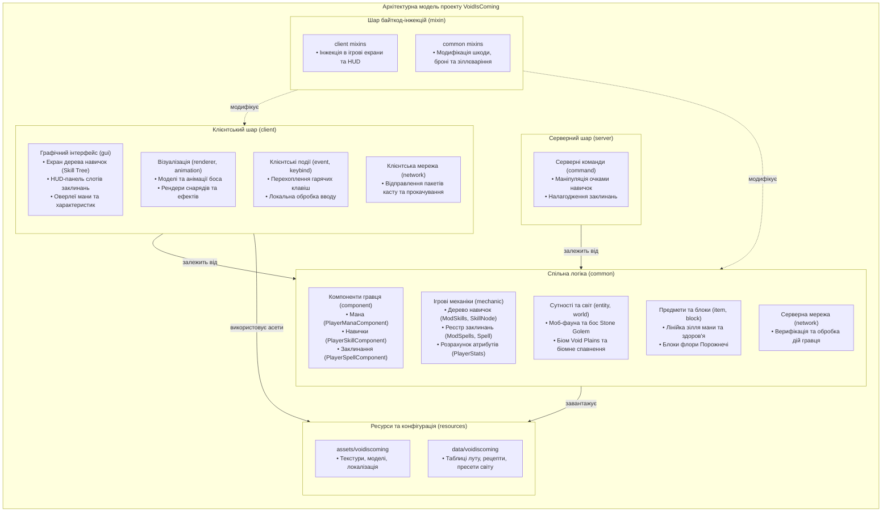

[English](README.md) | **Українська**


# Void Is Coming

**Хардкорний RPG-мод для Minecraft: оберіть клас, розвивайтеся через дерево навичок, використовуйте заклинання за ману та зустріньте мешканців Рівнин Порожнечі.**

   


## Концепція проєкту

Базова система прогресії Minecraft зорієнтована переважно на накопичення матеріальних ресурсів та покращення спорядження. Модифікація **Void Is Coming** інтегрує повноцінний рольовий вимір (RPG-систему), у якому ключовим фактором ефективності стає розвиток самого персонажа. Бойові параметри, характеристики мобільності та доступний арсенал магічних умінь визначаються обраною спеціалізацією та конфігурацією дерева навичок.

- **Нелінійна система розвитку**: формування індивідуального стилю гри через розгалужене дерево взаємовиключних спеціалізацій (Воїн, Лучник, Маг).
- **Динамічна прогресія атрибутів**: конвертація рівнів досвіду в очки навичок, що дозволяють поступово розблоковувати пасивні модифікатори та активні вміння.
- **Менеджмент магічного ресурсу**: інтеграція пулу мани, параметрів перезарядки та варіативних витрат ресурсів під час бою.
- **Уніфікована бойова архітектура**: зброя ближнього й дальнього бою, параметри броні та магічні здібності розраховуються за єдиною модульною системою характеристик.
- **Підвищена складність виживання**: вимкнення пасивної регенерації та інтеграція небезпечних сутностей створюють виклики, які вимагають тактичного планування та використання ресурсів.

## Основні можливості

### Класи та дерево навичок


Графічне вузлове дерево навичок із чіткою структурою залежностей та трьома спеціалізованими класовими напрямами:

- **Механіка отримання очок**: підвищення рівня персонажа генерує очки навичок (`Skill Points`), які гравець інвестує у відкриття наступних вузлів.
- **Вузлова архітектура**: дерево складається з базових навичок, класових виборів, проміжних пасивних модифікаторів та бойових здібностей.
- **Взаємовиключні спеціалізації**: вибір одного основного класу блокує доступ до двох інших гілок, формуючи чітко виражені архетипи:
  - **Воїн (Warrior)**: фокус на важку броню, стійкість до шкоди (`Resilience`), збільшення ефективності клинків та виживання в ближньому контакті.
  - **Лучник (Archer)**: підвищений запас здоров'я, висока швидкість пересування, посилення стрільби з дистанційної зброї, скритність і тактичне позиціювання.
  - **Маг (Mage)**: масштабування максимального запасу мани, підвищення магічної спорідненості (`Affinity`), просторова мобільність, контроль території та захисні бар'єри.
- **Скидання навичок**: реалізовано механізм повного перерозподілу очок (`Skill Reset`), що дозволяє адаптувати білд персонажа під зміну тактичних завдань.

### Система мани

Мана є основним ресурсом для використання магічних механік мода:

- **Базові показники та динамічне масштабування**: базовий запас становить 20 одиниць. Максимальний обсяг мани динамічно розраховується на основі рівня персонажа, класової належності та розблокованих модифікаторів магічного резервуара.
- **Магічна спорідненість (`Affinity`)**: характеристика, що оптимізує витрату мани при застосуванні заклинань, пропорційно знижуючи їхню собівартість.
- **Інтерфейс контролю (HUD)**: виділений елемент графічного інтерфейсу, що відображає поточний та граничний рівень мани в реальному часі поруч зі смужками здоров'я й броні.
- **Відновлення ресурсу**: запас мани поповнюється за допомогою алхімічних зіль різної концентрації та місткості.

### Система заклинань

Магічна підсистема поєднує активні маніпуляції та умовні пасивні ефекти без потреби розкриття всього арсеналу наперед:

- **Панель швидкого доступу (Spell Hotbar)**: окремий інтерфейс слотів швидкого використання (з можливістю розширення кількості активних комірок від 2 до 4), що дозволяє призначати та комбінувати вивчені здібності.
- **Оперативне застосування**: активація заклинань призначається на окремі гарячі клавіші для зручного використання в динамиці бою.
- **Баланс вартості та відновлення**: кожна здібність має визначену ціну (витрата мани або плата власним здоров'ям) і таймер перезарядки (cooldown). Окремі вузли дерева дозволяють системно скорочувати час відновлення вмінь.
- **Категорії здібностей**:
  - **Активні бойові та тактичні вміння**: оперативне відновлення життєвих сил, миттєве тактичне переміщення у просторі, імпульсні зони холоду із накладанням сповільнення та замерзання на супротивників, бойовий транс, захисні бар'єри та розсіювання негативних ефектів.
  - **Пасивні та тригерні ефекти**: приховані механіки, які автоматично активуються під час усунення ворогів, підтримання граничного рівня мани чи падіння здоров'я до критичних позначок.

### Рівнини Порожнечі та їхні мешканці


Окремий біом із власною рослинністю та специфічною атмосферою, заселений мутованими істотами Порожнечі та охоронюваний унікальним босом — Кам'яним големом. Поведінка та параметри мобів орієнтовані на комплексну перевірку боєздатності персонажа.

### Додаткові системи

- **Користувацькі атрибути сутностей**: динамічний перерахунок максимального здоров'я, броні, швидкості пересування, мани та вихідної шкоди.
- **Розширена алхімія**: лінійка зілля здоров'я та мани різної місткості.
- **Кастомний інтерфейс**: повноцінне вікно дерева навичок та HUD-оверлеї життєвих показників і слотів заклинань.
- **Внутрішньоігровий посібник**: спеціалізована книга для навігації та відстеження прогресу гравця.

## Встановлення та запуск

### Системні вимоги

- **Minecraft**: `1.20.1`
- **Завантажувач модів**: [Fabric Loader](https://fabricmc.net/use/) `>=0.14.0`
- **Обов'язкові бібліотеки**:
  - [Fabric API](https://modrinth.com/mod/fabric-api)
  - [Cardinal Components API (CCA)](https://modrinth.com/mod/cardinal-components-api)

### Встановлення через Pinecone MC Launcher

1. Відкрийте меню керування грою: натисніть **Edit** у правому верхньому куті, далі виберіть розділ **Mods**.

   

2. Натисніть **Download Mods**, виберіть каталог **CurseForge** та введіть у пошук **Void Is Coming**.
3. У нижній частині вікна натисніть **Select mod for download**, після чого підтвердіть дію кнопкою **Review and confirm**.
4. Запустіть гру за допомогою кнопки **Launch**.

   

<details>
<summary>Ручне встановлення у клієнт</summary>

1. Встановіть чистий клієнт Minecraft 1.20.1 із завантажувачем Fabric.
2. Завантажте актуальні версії бібліотек Fabric API та Cardinal Components API.
3. Отримайте скомпільований `.jar` файл Void Is Coming зі сторінки [GitHub Releases](https://github.com/mykytenko-petro/VoidIsComing/releases) (або з платформ CurseForge, Modrinth).
4. Перемістіть усі завантажені файли з розширенням `.jar` до директорії `.minecraft/mods`.
5. Запустіть клієнт із профілем Fabric та переконайтеся у коректній ініціалізації мода.

</details>

<details>
<summary>Компіляція з вихідного коду</summary>

Для збірки потрібне встановлене середовище виконання **JDK 17+**.

```bash
git clone https://github.com/mykytenko-petro/VoidIsComing.git
cd VoidIsComing
./gradlew build
./gradlew runClient
```

Для операційних систем Windows замість `./gradlew` використовуйте скрипт `gradlew.bat`.

</details>

## Архітектура та структура проєкту

Архітектурний дизайн модифікації побудований за принципом суворого розділення обов'язків (Separation of Concerns) та забезпечення клієнт-серверної ізоляції, прийнятої в екосистемі Fabric.



### Модульна організація пакетів

- **`client`**: відповідає за рендеринг моделей, анімації боса (`Stone Golem`), графічний інтерфейс (`gui`), HUD-оверлеї (панель заклинань, смужка мани, дерево навичок), обробку клієнтських подій і реєстрацію клавіш швидкого доступу (`keybind`).
  > **Правило залежностей**: клієнтські класи можуть використовувати спільні типи з `common`, проте код із `common` у жодному разі не імпортує класи з `client`. Це гарантує стабільну роботу на виділених серверах (dedicated servers) без графічного оточення.
- **`common`**: ядро модифікації, що містить платформонезалежну ігрову логіку. Включає:
  - `component`: стан гравця (мана, дерево навичок, екіпіровані заклинання) на базі Cardinal Components API (CCA).
  - `mechanic`: логіка розрахунку характеристик, дерево навичок і система заклинань.
  - `entity` та `world`: штучний інтелект мобів Порожнечі, бос та генерація біому.
  - `item` та `block`: кастомні предмети (зілля, книга знань) та блоки біому.
  - `network`: реєстрація мережевих каналів та обробка пакетів на боці сервера.
- **`server`**: специфічна серверна функціональність, включно з консольними командами адміністрування та налагодження (`command`), роботою з очками навичок і тестуванням механік.
- **`mixin`**: класи модифікації поведінки ванільного рушія Minecraft через байткод-інжекції:
  - `client`: доступ до закритих полів екранів та модифікація відображення HUD.
  - `common`: перехоплення розрахунку шкоди, механік захисту бронею, голоду, використання луків та взаємодії із зіллєваркою.
- **`resources`**: конфігураційні файли, реєстри NBT-тегів, дескриптори крафту, таблиці луту та клієнтські асети (моделі, текстури, файли перекладу).

## Опис коду

### `common/VoidIsComing.java` — головний клас мода

**Призначення:** головний клас, який відповідає за початкову ініціалізацію мода VoidIsComing. Він підключає основні системи мода під час запуску Minecraft.

#### Основні елементи

- `MOD_ID` — постійний ідентифікатор мода зі значенням `voidiscoming`. Використовується для створення ідентифікаторів ресурсів.
- `LOGGER` — об'єкт для запису повідомлень у журнал.
- `onInitialize()` — метод, який Fabric викликає під час ініціалізації мода.
- `id(String path)` — допоміжний метод для створення ідентифікаторів Minecraft із простором імен `voidiscoming`.

#### Як працює `onInitialize()`

Метод `onInitialize()` послідовно викликає методи реєстрації та налаштування інших систем мода:

- `ModItems.initialize()` — ініціалізація предметів.
- `ModEntities.registerModEntities()` — реєстрація типів мобів.
- `ModMechanics.registerMechanics()` — реєстрація ігрових механік.
- `ModCommands.registerCommands()` — реєстрація команд.
- `ModEntitySpawns.register()` — реєстрація налаштувань появи мобів.
- `ModBlocks.initialize()` — ініціалізація блоків.
- `ModItemGroups.initialize()` — налаштування груп предметів.
- `ModNetworking.registerPackets()` — реєстрація мережевих пакетів.
- `ModEffects.registerEffects()` — реєстрація ефектів.
- `ModBiomes.register()` — реєстрація біомів.
- `VoidWorldSpawn.register()` — налаштування появи елементів мода у світі.
- `VoidTreeGeneration.register()` — реєстрація генерації дерев.
- `ModBrewingRecipes.registerRecipes()` — реєстрація рецептів варіння.
- `ModEvents.registerEvents()` — реєстрація обробників подій.

Самі ігрові механіки реалізовані в окремих класах. `VoidIsComing.java` викликає відповідні методи, щоб підключити їх під час запуску мода.

#### Приклад використання методу `id()`

```java
Identifier wandId = VoidIsComing.id("wooden_wand");
```

Результат — ідентифікатор `voidiscoming:wooden_wand`.

Цей метод спрощує створення ідентифікаторів і допомагає уникнути повторення простору імен мода в коді.

#### Що варто знати початківцю

1. `implements ModInitializer` пов'язує клас із механізмом ініціалізації Fabric.
2. `@Override` вказує, що клас реалізує метод, оголошений в інтерфейсі або батьківському класі.
3. Виклики `SomeClass.someMethod()` дають змогу розділяти код між різними класами.
4. Якщо потрібно знайти реалізацію певної механіки, варто перейти до відповідного класу, виклик якого знаходиться в `onInitialize()`.


### `client/VoidIsComingClient.java` — ініціалізація клієнтської частини

**Призначення:** клас відповідає за початкове налаштування клієнтської частини мода VoidIsComing. Він підключає рендерери, кольори блоків, клавіші керування, клієнтські події та графічний інтерфейс.

#### Основні елементи

- `VoidIsComingClient` — головний клас клієнтської частини мода.
- `onInitializeClient()` — метод, який Fabric викликає під час ініціалізації клієнтської частини.
- `ModRenderers.registerRenderers()` — реєстрація рендерерів мобів та їхніх візуальних елементів.
- `ModBlockColors.register()` — реєстрація кольорів блоків.
- `ModKeyBindings.registerBindings()` — реєстрація клавіш керування модом.
- `ClientModEvents.registerEvents()` — реєстрація обробників клієнтських подій.
- `ModGUI.init()` — ініціалізація графічного інтерфейсу.

#### Налаштування відображення саджанця

```java
BlockRenderLayerMap.INSTANCE.putBlock(
    ModBlocks.VOID_SAPLING,
    RenderLayer.getCutout()
);
```

Цей код призначає блоку `VOID_SAPLING` шар рендерингу `cutout`. Він використовується для текстур із повністю прозорими та непрозорими ділянками, наприклад для рослин із прозорим фоном між частинами текстури.

`ModBlocks.VOID_SAPLING` належить до спільної частини мода, а налаштування його відображення виконується на клієнті.

#### Що варто знати початківцю

1. `ClientModInitializer` використовується для ініціалізації клієнтської частини Fabric-мода.
2. Клієнтський код відповідає за відображення, графічний інтерфейс і керування з боку гравця.
3. Виклик методу іншого класу дає змогу розділяти функціональність між окремими компонентами.
4. Клієнтська частина може використовувати класи з `common`, але код із `common` не повинен імпортувати класи з `client`.
5. Клієнтські класи не слід використовувати в серверній логіці, оскільки виділений сервер не має клієнтського графічного інтерфейсу та рендерингу.


### `common/item/ModItems.java` — реєстрація предметів

**Призначення:** клас містить оголошення та реєстрацію предметів мода VoidIsComing. Тут створюються зілля мани, зілля лікування, магічні палички, есенція Порожнечі, предмети, що випадають із мобів, порожні пляшки та книга мода.

#### Основні елементи

- `SMALL_MANA_BOTTLE`, `MEDIUM_MANA_BOTTLE`, `LARGE_MANA_BOTTLE` — три різновиди зілля мани.
- `VOID_ESSENCE` — есенція Порожнечі.
- `EMPTY_SMALL_BOTTLE`, `BIG_EMPTY_BOTTLE` — порожні пляшки.
- `VOID_PIG_TAIL`, `VOID_COW_HORN`, `STONE_GOLEM_CORE` — предмети, пов'язані з мобами мода.
- `HEAL_BOTTLE` — зілля лікування.
- `WOODEN_STAFF`, `IRON_STAFF`, `DIAMOND_STAFF`, `NETHERITE_STAFF` — магічні палички різних рівнів.
- `MOD_BOOK` — книга мода.
- `register(String name, Item item)` — допоміжний метод для реєстрації предметів.
- `initialize()` — публічний метод ініціалізації класу.

#### Як працює реєстрація

Для кожного предмета оголошується поле, яке містить результат виклику методу `register()`.

```java
public static final Item VOID_ESSENCE = register(
    "void_essence",
    new Item(new Item.Settings())
);
```

Спочатку створюється об'єкт предмета, після чого він передається методу `register()`, який додає його до реєстру предметів Minecraft.

#### Метод `register()`

```java
private static Item register(String name, Item item) {
    return Registry.register(
        Registries.ITEM,
        new Identifier(VoidIsComing.MOD_ID, name),
        item
    );
}
```

Метод приймає назву предмета та його об'єкт, створює унікальний ідентифікатор із простором імен `voidiscoming` і реєструє предмет у `Registries.ITEM`.

Наприклад, предмет `wooden_wand` отримує ідентифікатор `voidiscoming:wooden_wand`.

Використання окремого методу дає змогу не повторювати код реєстрації для кожного предмета.

#### Налаштування предметів

За допомогою `Item.Settings` або `FabricItemSettings` задаються параметри предметів.

- `maxCount(1)` — предмет не можна складати в стопку більше ніж з одного екземпляра.
- `maxCount(16)` — максимальний розмір стопки становить 16 предметів.
- `maxDamage(60)` — задає максимальну міцність предмета.
- `new ManaPotionItem(...)`, `new HealBottleItem(...)` і `new WandItem(...)` — створюють предмети з власною поведінкою, реалізованою у відповідних класах.

Значення, передані конструкторам власних класів, визначають їхню поведінку відповідно до реалізації цих класів.

#### Навіщо потрібен `initialize()`

Метод `initialize()` викликається з головного класу `VoidIsComing.java`. Він порожній, оскільки реєстрація предметів виконується під час ініціалізації статичних полів класу `ModItems`.

#### Що варто знати початківцю

1. `static final` використовується для полів, які містять посилання на зареєстровані предмети.
2. `Registry.register()` додає об'єкт до реєстру Minecraft.
3. `Identifier` формує унікальну назву ресурсу з простору імен і локальної назви.
4. Власні класи предметів дають змогу реалізовувати поведінку, якої немає у звичайного `Item`.
5. Реєстрація предмета та його поведінка — це різні речі: `ModItems.java` створює й реєструє предмет, а його спеціальна логіка визначається відповідним класом.


### `ManaPotionItem.java` — зілля мани

**Розташування:** `src/main/java/com/voidiscoming/common/item/consumables/ManaPotionItem.java`

Клас `ManaPotionItem` відповідає за поведінку зіль мани. Він успадковується від `PotionItem` і перевизначає метод `finishUsing()`, який виконується після завершення використання предмета.

#### Зберігання кількості мани

Поле `manaAmount` зберігає кількість мани, яку потрібно додати гравцеві. Це значення передається через конструктор під час створення зілля.

```java
private final double manaAmount;
```

#### Відновлення мани

На серверній стороні метод `finishUsing()` перевіряє, чи використав предмет гравець. Потім код отримує компонент мани через `ModComponents.MANA.get(player)`, додає задану кількість мани методом `addMana()` і синхронізує компонент за допомогою `ModComponents.MANA.sync(player)`.

Перевірка `!world.isClient` потрібна, щоб зміна мани виконувалася на сервері, а не одночасно на клієнті та сервері.

#### Повернення порожньої пляшки

Після використання зілля гравець не в творчому режимі отримує порожню скляну пляшку.

- `stack.decrement(1)` зменшує кількість зіль на один.
- Якщо зіль більше не залишилося, метод повертає порожню пляшку замість використаного предмета.
- Якщо зілля ще залишилися, пляшка додається до інвентаря.
- Якщо в інвентарі немає місця, пляшка випадає у світ.

У творчому режимі цей код не витрачає зілля та не видає порожню пляшку.

#### Що варто запам'ятати

- **Конструктор** задає початкові параметри об'єкта.
- **`@Override`** означає, що клас перевизначає метод батьківського класу.
- **`instanceof`** перевіряє тип об'єкта.
- **`ItemStack`** представляє предмет або набір предметів.
- **`return`** завершує метод і повертає результат.
- **Тернарний оператор `? :`** дає змогу записати просту умову в один рядок.

Цей клас показує, як змінювати поведінку стандартного предмета Minecraft, взаємодіяти з компонентом гравця та керувати предметами після використання.

### `PlayerManaComponent.java` — компонент мани гравця

**Розташування:** `src/main/java/com/voidiscoming/common/component/mana/PlayerManaComponent.java`

Клас реалізує інтерфейс `ManaComponent` і відповідає за збереження, розрахунок та синхронізацію мани конкретного гравця за допомогою бібліотеки Cardinal Components API (CCA).

#### Основні елементи

- `mana` — поточний запас мани персонажа (початкове значення — 20.0f).
- `player` — гравець, до якого прив'язаний компонент.
- `getMaxMana()` — повертає максимальну ману гравця, динамічно обчислювану через `PlayerStats.MAX_MANA.getValue(player)`.
- `setMana(float mana)` — встановлює значення мани, безпечно обмежуючи його в діапазоні від `0.0` до `getMaxMana()`, та синхронізує стан між сервером і клієнтом.
- `addMana(double amount)` / `removeMana(double amount)` — додавання та списання мани.
- `readFromNbt()` / `writeToNbt()` — збереження поточного рівня мани у форматі NBT при збереженні світу чи переході між вимірами.

#### Як працює зміна мани

```java
@Override
public void setMana(float mana) {
    this.mana = (float) Math.max(0.0, Math.min(mana, getMaxMana()));
    ModComponents.MANA.sync(this.player);
}
```

Клієнтська сторона не змінює значення мани напряму — усі модифікації виконуються на сервері, після чого метод `sync()` передає оновлене значення на клієнт для відображення в HUD.

---

### `PlayerSkillComponent.java` та `SkillNode.java` — система та дерево навичок

**Розташування:**
- `src/main/java/com/voidiscoming/common/component/skill/PlayerSkillComponent.java`
- `src/main/java/com/voidiscoming/common/mechanic/skill/SkillNode.java`
- `src/main/java/com/voidiscoming/common/mechanic/skill/ModSkills.java`

Модуль відповідає за рольову прогресію гравця, дерево навичок і взаємовиключні класи.

#### Вузли дерева навичок (`SkillNode`)

Кожен вузол дерева представляє об'єкт `SkillNode` із такими параметрами:
- `id` — унікальний ідентифікатор навички (`Identifier`).
- `parentId` — ідентифікатор батьківського вузла, необхідного для відкриття поточної навички. Якщо вузол кореневий (`isRoot()`), батько відсутній.
- `cost` — кількість очок навичок, необхідних для вивчення.
- `type` — тип навички: `CLASS` (клас), `REGULAR` (пасивні характеристики) або `SPELL` (розблокування заклинання).
- `mutuallyExclusiveNodes` — список ідентифікаторів навичок, несумісних із цією (наприклад, вибір класу `WARRIOR_CLASS` блокує `ARCHER_CLASS` та `MAGE_CLASS`).

#### Керування навичками у `PlayerSkillComponent`

1. **Отримання очок навичок**: слухач `PlayerLevelUpCallback.EVENT` відстежує підвищення рівня досвіду гравця та нараховує відповідну кількість очок через `addSkillPoints()`.
2. **Перевірка умов розблокування (`canUnlock`)**:
   - Перевіряє, чи навичка ще не розблокована.
   - Перевіряє відсутність уже активованих взаємовиключних навичок.
   - Перевіряє наявність достатньої кількості очок (`skillPoints >= node.cost()`).
   - Перевіряє, чи відкрито батьківський вузол (`hasUnlocked(node.parentId())`).
3. **Розблокування (`unlockSkill`)**: списує вартість в очках, додає ідентифікатор до списку `unlockedSkills` та синхронізує компонент:
   ```java
   SkillNode node = ModSkills.get(skillId);
   this.skillPoints -= node.cost();
   this.unlockedSkills.add(skillId);
   ModComponents.SKILLS.sync(player);
   ```
4. **Скидання дерева навичок (`resetSkills`)**: повертає всі витрачені очки назад гравцеві, очищає вивчені навички та автоматично скидає екіпіровані заклинання.

---

### `PlayerSpellComponent.java` та `Spell.java` — система та механіка заклинань

**Розташування:**
- `src/main/java/com/voidiscoming/common/component/spell/PlayerSpellComponent.java`
- `src/main/java/com/voidiscoming/common/mechanic/spell/Spell.java`
- `src/main/java/com/voidiscoming/common/mechanic/spell/ModSpells.java`

Цей модуль реалізує систему екіпірування, кулдаунів та виконання активних і пасивних заклинань.

#### Базовий клас `Spell`

Клас визначає базову логіку будь-якого заклинання в моді:
- **Поля:** `icon` (іконка для GUI/HUD), `cost` (базова вартість), `costType` (`ResourceCostType`: `MANA`, `HP` або `NONE`), `cooldownTicks` (тривалість перезарядки в ігрових тіках) та `isPassive` (чи є здібність пасивною).
- **Метод застосування (`cast`)**:
  1. Перевіряє кулдаун заклинання через `playerSpellComp.isOnCooldown(spellId)`.
  2. Вираховує фінальну вартість із врахуванням знижки від характеристики магічної спорідненості (`PlayerStats.getSpellCostReduction`).
  3. Перевіряє наявність ресурсу (мани у `PlayerManaComponent` або здоров'я) та списує його.
  4. Запускає перезарядку (`playerSpellComp.setCooldown(spellId, getCooldownTicks())`).
  5. Викликає метод поведінки заклинання: `castBehaviour(player)`.
- **Методи розширення для нащадків:**
  - `castBehaviour(PlayerEntity player)` — логіка виконання активного заклинання (наприклад, активний ефект чи просторове переміщення).
  - `onKill(PlayerEntity attacker, LivingEntity target)` — викликається при знищенні ворога (для механік поглинання життєвих сил чи бойових тригерів).
  - `onTick(PlayerEntity player)` — викликається кожен ігровий такт для пасивних ефектів (для постійних пасивних підсилень та контролю стану).

#### Компонент заклинань гравця (`PlayerSpellComponent`)

- **Слоти заклинань:** масив `equippedSpells` зберігає ідентифікатори екіпірованих заклинань. Кількість активних слотів (`unlockedSlots`) початково дорівнює 2 і може розширюватися до 4.
- **Екіпірування (`toggleSpell`)**: натискання по вивченому заклинання встановлює його у перший вільний слот або знімає зі слота, якщо воно вже було призначене.
- **Керування перезарядкою (`cooldownEnds`)**: відстежує точний час завершення кулдауну кожного заклинання в мілісекундах і синхронізує тривалість із клієнтом для відображення анімації перезарядки на панелі слотів.

---

## Команда проєкту

- [Петро Микитенко](https://github.com/mykytenko-petro): керівник команди, розробник, 2D-дизайнер
- [Вадим Кучмій](https://github.com/vxdlmchk-code): розробник, 2D-дизайнер
- [Андрій Скульський](https://github.com/andrewskulskuia): розробник, 2D-дизайнер, 3D-дизайнер
- [Микола Бояркін](https://github.com/KolyaBojarkin): розробник, 2D-дизайнер

## Повідомлення про помилки та ліцензія

Знайшли вразливість, помилку чи маєте пропозицію щодо оптимізації? Створіть [issue](https://github.com/mykytenko-petro/VoidIsComing/issues). Pull request-и вітаються.

Проєкт поширюється за відкритою [ліцензією MIT](LICENSE).

---

## Висновки

У ході реалізації модифікації **Void Is Coming** для платформи Minecraft (версія 1.20.1, завантажувач Fabric) розроблено та протестовано повноцінну модульну RPG-систему, інтегровану в базовий ігровий рушій. Проєкт пройшов повний життєвий цикл розробки програмного продукту: від проєктування системної архітектури до впровадження користувацького інтерфейсу, мережевої синхронізації та збалансування ігрового процесу.

### 1. Архітектурні рішення та технічні результати
- **Компонентно-орієнтований підхід**: використання Cardinal Components API (CCA) забезпечило слабку зв'язаність (loose coupling) модулів збереження стану персонажа (мана, дерево навичок, заклинання), надійну серіалізацію у формат NBT та автоматичну реплікацію даних між сервером і клієнтом.
- **Модульне дерево навичок**: спроєктовано графову структуру вузлів (`SkillNode`) із підтримкою динамічної валідації умов, взаємовиключних спеціалізацій та безпечного механізму повернення ресурсів (respec).
- **Поліморфізм заклинань**: реалізовано розширювану ієрархію вмінь (`Spell`) із гнучким контролем життєвого циклу (активація, тактові оновлення, обробка бойових подій) та підтримкою різних типів витрат ресурсів (`MANA`, `HP`, `NONE`).
- **Синхронізація клієнт-сервер**: усі критичні розрахунки (витрати ресурсів, нанесення шкоди, перевірка перезарядки) виконуються авторитетним сервером із передачею валідованих станів на клієнтську сторону.

### 2. Візуальне оформлення та інтерфейс користувача (UI/UX)
- Спроєктовано та впроваджено кастомний графічний екран дерева навичок із візуалізацією з'єднань між вузлами та контекстними інформаційними панелями.
- Розроблено адаптивний бойовий інтерфейс (HUD): шкалу магічного ресурсу та панель швидкого доступу до активних слотів заклинань з анімацією перезарядки.
- Створено авторські 2D- іконки та 3D-моделі із процедурними анімаціями сутностей.

### 3. Організація командної роботи та версіонування
- Налагоджено робочий процес із використанням системи контролю версій Git та репозиторію GitHub: ізоляція розробки функціоналу за допомогою тематичних гілок, регулярний взаємний код-рев'ю та розв'язання конфліктів злиття.
- Забезпечено суворе дотримання архітектурного правила ізоляції: клієнтські класи не імпортуються у спільну чи серверну логіку, що гарантує сумісність із виділеними серверами (dedicated servers).

### 4. Подолані технічні виклики
- **Усунення десинхронізації та збоїв збереження**: виправлено проблеми серіалізації даних гравця (`InvalidPlayerdata`) за рахунок структурованого збереження списків розблокованих ідентифікаторів у NBT-компоненти.
- **Оптимізація обчислень характеристик**: мінімізовано навантаження на ігровий такт шляхом виклику перерахунку статів лише при зміні екіпірування, рівня або вивченні навичок.
- **Гнучкий баланс**: інтегровано параметри магічної спорідненості (`Affinity`) та захисної стійкості (`Resilience`), що забезпечує масштабованість системи при додаванні нового контенту.

Розроблений мод "VoidIsComing" демонструє комплексний підхід до розширення внутрішніх механік Minecraft на платформі Fabric, відповідає принципам чистої архітектури та об'єктно-орієнтованого програмування й слугує готовим практичним кейсом для інженерного портфоліо.
