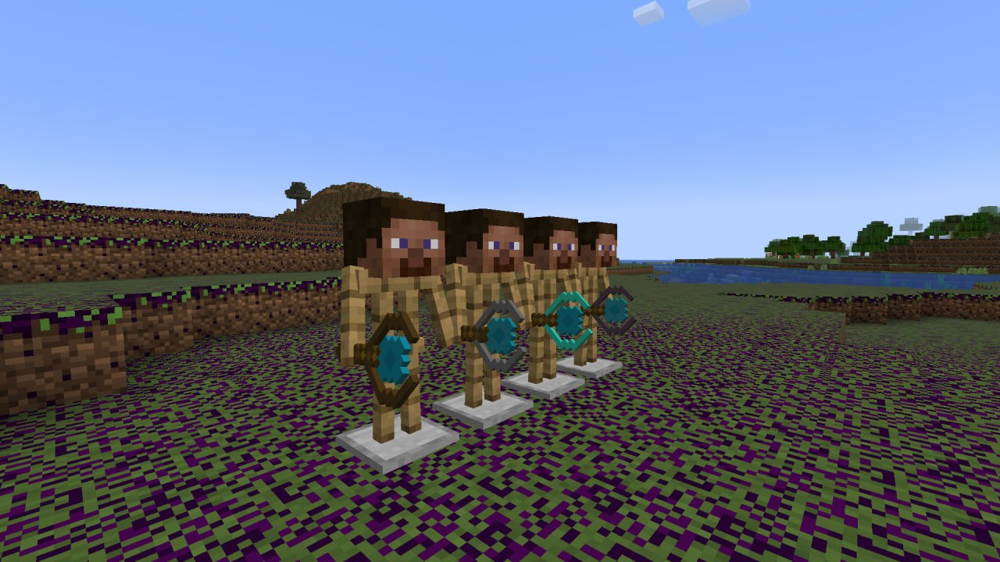

[English](README.md) | **Українська**


# Void Is Coming

**Хардкорний RPG-мод для Minecraft: оберіть клас, розвивайтеся через дерево навичок, використовуйте заклинання за ману та зустріньте мешканців Рівнин Порожнечі.**

   


## Ідея

У звичайному Minecraft прогрес — це переважно кращі матеріали. **Void Is Coming** додає другий рівень: ваш персонаж теж розвивається. Бій, пересування та магія залежать від обраного класу та відкритих навичок, тож двоє гравців з однаковим спорядженням можуть грати зовсім по-різному.

- **Прогрес, який обираєте ви.** Оберіть шлях у дереві навичок: Воїн, Лучник або Маг.
- **Рівні дають очки навичок.** Кожен новий рівень нагороджує очками, які ви витрачаєте на нові навички.
- **Заклинання з ціною.** Екіпіруйте заклинання та керуйте маною під час бою.
- **Одна система для всього.** Мечі, луки, палички та заклинання масштабуються від спільної системи навичок і характеристик, тому гра послідовна, а мод легко розширювати.
- **Хардкорне виживання.** Немає пасивної регенерації, а істоти Порожнечі значно складніші за ванільних мобів, тож кожен бій і кожне зілля мають значення.

## Можливості

### Класи та дерево навичок


Вузлове дерево навичок із трьома гілками. Навички відкривають пасивні бонуси, надають доступ до заклинань і відкривають шлях до подальшого розвитку.

- **Воїн**: броня та бонуси для ближнього бою.
- **Лучник**: додаткове здоров'я, швидкість, бонуси до луків та навички скритності й виявлення.
- **Маг**: зростання мани, сила паличок, допоміжні заклинання, мобільність і відновлення.

### Заклинання та мана

Екіпіруйте заклинання та використовуйте їх за ману. Деякі заклинання активні, інші працюють пасивно або спрацьовують при вбивстві.

### Рівнини Порожнечі та їхні мешканці


Новий біом «Рівнини Порожнечі» з власними деревами та травою. Тут мешкають Свині, Корови та Вівці Порожнечі, а охороняє їх Кам'яний голем — сильний моб рівня боса. Ці моби набагато складніші за ванільних і дають вашим навичкам гідне випробування.

### Магічні палички



Палички різних рівнів (дерев'яна, залізна, діамантова, незеритова) стріляють власними снарядами. Їхня шкода залежить від рівня палички та відкритих навичок.

### І не тільки

- **Власні характеристики гравця**: динамічне масштабування здоров'я, броні, швидкості пересування, мани та шкоди.
- **Витратні предмети**: зілля здоров'я та мани.
- **Власний інтерфейс**: екран дерева навичок та HUD-елементи для мани, характеристик і екіпірованих заклинань.
- **Ігровий посібник**: книга для відстеження прогресу.

### Висновок
У ході розробки модифікації "VoidIsComing" для Minecraft (версія 1.20.1 на базі Fabric) ми пройшли повний цикл створення програмного продукту — від початкової ідеї та проєктування архітектури до реалізації геймплейних механік і тестування. Цей проєєкт став потужним практичним майданчиком для закріплення навичок у різних галузях розробки та геймдизайну.

1. Технічні навички та програмування
Робота над модом вимагала глибокого занурення в мову програмування Java та активного застосування принципів об'єктно-орієнтованого програмування (ООП). Ми на практиці реалізували ієрархії класів (на прикладі системи заклинань та базових статів), використовували поліморфізм для створення унікальних здібностей (як-от пасивні ефекти та активні скілли) та інкапсуляцію для безпечного керування даними гравця.
Окрему увагу було приділено роботі з компонентами даних через Cardinal Components API (CCA), синхронізації стану між сервером і клієнтом, а також серіалізації даних у форматі NBT для забезпечення їх збереження між ігровими сесіями.

2. Дизайн та візуальне оформлення
Геймдев — це не лише код, а й візуальна складова. У рамках проєкту ми працювали над 2D- та 3D-дизайном: створювали іконки для заклинань, елементи інтерфейсу (GUI) та продумували користувацький досвід (UX/UI), щоб взаємодія з магічною системою була інтуїтивно зрозумілою та зручною для гравця.

3. Командна робота та інструменти розробки
Розробка такого масштабу була б неможливою без злагодженої командної взаємодії. Ми на практиці опанували роботу з системою контролю версій Git та платформою GitHub:

Налаштували спільну роботу над репозиторієм.

Використовували гілки для розробки окремих фіч (системи спеллів, команд дебагу, компонентів).

Начилися вирішувати конфлікти злиття (merge conflicts) та проводити рев'ю коду один одного.

4. Головні виклики проєкту
Під час створення мода ми зіткнулися з низкою серйозних труднощів, подолання яких значно підвищило наш технічний рівень:

Архітектура магічної системи: Проєктування гнучкої системи слотів, кулдаунів та динамічного розрахунку характеристик гравця без зайвого дублювання коду (DRY).

Синхронізація даних: Вирішення проблем із падіннями сервера (InvalidPlayerdata), правильна передача даних NBT та синхронізація компонентів між клієнтом і сервером.

Балансування та оптимізація: Уникнення зайвих обчислень за допомогою оптимізації викликів та спрощення логіки розрахунків статів.

5. Практична цінність
Створений нами мод "VoidIsComing" демонструє глибоке розуміння того, як влаштований внутрішній код Minecraft на платформі Fabric. Цей проєєкт може слугувати чудовим прикладом та основою для створення складних ігрових модифікацій, а набутий досвід у програмуванні, роботі з архітектурою та командній взаємодії є готовим кейсом для портфоліо.

Нашими найбільшими труднощами були:

- **Навички та заклинання**: створення навичок, які справді змінюють поведінку зброї та паличок, і синхронізація цих даних з гравцем.
- **Анімації**: щоб нові моби та бос виглядали живими.
- **Генерація світу (біоми)**: створення нового ландшафту, що пасує до атмосфери моду.

Наш мод також може бути корисним прикладом для розробки модифікацій для Minecraft (Fabric).

## Команда

- [Петро Микитенко](https://github.com/mykytenko-petro): керівник команди, розробник, 2D-дизайнер
- [Вадим Кучмій](https://github.com/vxdlmchk-code): розробник, 2D-дизайнер
- [Андрій Скульський](https://github.com/andrewskulskuia): розробник, 2D-дизайнер, 3D-дизайнер
- [Микола Бояркін](https://github.com/KolyaBojarkin): розробник, 2D-дизайнер

## Встановлення

### Вимоги

- Minecraft `1.20.1`
- [Fabric Loader](https://fabricmc.net/use/) `>=0.14.0`
- [Fabric API](https://modrinth.com/mod/fabric-api)
- [Cardinal Components API](https://modrinth.com/mod/cardinal-components-api)

### Встановлення через Pinecone MC Launcher

1. Натисніть **Edit** у правому куті, а потім **Mods**.

   

2. Натисніть **Download Mods**, виберіть **CurseForge** та знайдіть **Void Is Coming**.
3. Внизу натисніть **Select mod for download**, потім **Review and confirm**.
4. Натисніть **Launch**.

   

<details>
<summary>Ручне встановлення</summary>

1. Встановіть Minecraft 1.20.1 із завантажувачем Fabric.
2. Завантажте Fabric API та Cardinal Components API.
3. Завантажте останній `.jar` файл Void Is Coming зі сторінки [GitHub Releases](https://github.com/mykytenko-petro/VoidIsComing/releases) (також доступний на CurseForge, Modrinth та PlanetMC).
4. Покладіть усі `.jar` файли до `.minecraft/mods`.
5. Запустіть Minecraft з профілем Fabric і перевірте, чи мод завантажився.

</details>

<details>
<summary>Збірка з вихідного коду</summary>

Потрібна Java 17+ (перевірте конфігурацію Gradle, якщо збірка вимагає новішої версії).

```bash
git clone https://github.com/mykytenko-petro/VoidIsComing.git
cd VoidIsComing
./gradlew build
./gradlew runClient
```

У Windows використовуйте `gradlew.bat` замість `./gradlew`.

</details>

## Повідомлення про помилки та внесок

Знайшли помилку або маєте ідею? Створіть [issue](https://github.com/mykytenko-petro/VoidIsComing/issues). Pull request-и вітаються.

## Ліцензія

Проєкт поширюється за [ліцензією MIT](LICENSE).

## Опис

client

Папка містить код клієнтської частини мода, який відповідає за графічний інтерфейс, візуалізацію та взаємодію гравця з клієнтськими елементами мода.

Основний вміст:

animation — анімації моба Stone Golem.

blockcolor — налаштування кольорів блоків.

event — обробники клієнтських подій, навичок і заклинань.

gui — графічний інтерфейс, HUD, панелі характеристик, відображення мани, панель заклинань і дерево навичок.

keybind — налаштування клавіш керування модом.

model — моделі мобів і шари моделей.

network — відправлення клієнтських мережевих запитів для покращення навичок, скидання навичок, використання та екіпірування заклинань.

renderer — рендерери мобів і додаткових візуальних елементів.

VoidIsComingClient.java — точка входу клієнтської частини мода.

Правило залежностей: код із папки common не повинен імпортувати класи з client. Клієнтський код може використовувати спільні класи з common, але спільна логіка не повинна залежати від клієнтських компонентів.

common

Папка містить основну спільну логіку мода. Тут розміщуються блоки, предмети, моби, ігрові механіки, компоненти гравця, мережеві обробники та генерація світу.

Основний вміст:

block — блоки мода, зокрема трава Порожнечі, листя, колоди та саджанці.

component — компоненти гравця для зберігання мани, навичок і заклинань.

effects — реєстрація та реалізація ефектів, зокрема вразливості.

entity — моби Void Cow, Void Pig, Void Sheep, Stone Golem, їхні механіки та снаряди.

event — обробники ігрових подій, подій блоків і серверних подій.

item — предмети мода, книга, групи предметів, магічні палички, зілля здоров'я та мани.

mechanic — ігрові механіки: рівні гравця, обмеження броні за рівнем, характеристики, навички та заклинання.

network — реєстрація мережевих каналів і серверні обробники запитів, пов'язаних із навичками та заклинаннями.

recipe — рецепти приготування зілля.

world — біоми, генерація дерев і рослинності, налаштування появи мобів та генерація світу.

VoidIsComing.java — основна точка входу мода.

Правило залежностей: папка common не повинна імпортувати класи з client. Увесь код, необхідний для спільної ігрової логіки, має залишатися незалежним від клієнтського інтерфейсу та рендерингу.

server

Папка містить серверні команди та функціональність, призначену для виконання сервером.

Основний вміст:

command — команди мода, керування очками навичок, налагодження заклинань і тестові команди.

ModCommands.java — реєстрація команд мода.

SkillPointsCommand.java — команда для роботи з очками навичок.

SpellDebugCommand.java — команда для налагодження заклинань.

TestCommand.java — тестова команда.

Правило залежностей: серверний код не повинен залежати від клієнтських класів із client, оскільки серверна логіка має працювати без графічного інтерфейсу та клієнтського рендерингу.

mixin

Папка містить Mixin-класи, які змінюють або розширюють поведінку стандартних класів Minecraft.

client — зміни клієнтського інтерфейсу та доступ до внутрішніх елементів екранів.

common — зміни механік отримання шкоди, броні, голоду, їжі, молока, луків, варильних стійок і генерації біомів.

resources

Папка містить ресурси та конфігураційні файли мода.

assets/voidiscoming — текстури, моделі блоків і предметів, текстури мобів, іконки навичок і заклинань, локалізація та інші клієнтські ресурси.

data/voidiscoming — таблиці випадіння предметів, рецепти крафту та налаштування генерації світу.

data/minecraft — доповнення до стандартних тегів Minecraft.

fabric.mod.json — основна конфігурація мода Fabric.

voidiscoming.mixins.json — конфігурація Mixin-класів.

## Опис коду

### `common/VoidIsComing.java` — головний клас мода

**Призначення:** головний клас, який відповідає за початкову ініціалізацію мода VoidIsComing. Він підключає основні системи мода під час запуску Minecraft.

#### Основні елементи

- `MOD_ID` — постійний ідентифікатор мода зі значенням `voidiscoming`. Використовується для створення ідентифікаторів ресурсів.
- `LOGGER` — об'єкт для запису повідомлень у журнал.
- `onInitialize()` — метод, який Fabric викликає під час ініціалізації мода.
- `id(String path)` — допоміжний метод для створення ідентифікаторів Minecraft із простором імен `voidiscoming`.

#### Як працює `onInitialize()`

Метод `onInitialize()` послідовно викликає методи реєстрації та налаштування інших систем мода:

- `ModItems.initialize()` — ініціалізація предметів.
- `ModEntities.registerModEntities()` — реєстрація типів мобів.
- `ModMechanics.registerMechanics()` — реєстрація ігрових механік.
- `ModCommands.registerCommands()` — реєстрація команд.
- `ModEntitySpawns.register()` — реєстрація налаштувань появи мобів.
- `ModBlocks.initialize()` — ініціалізація блоків.
- `ModItemGroups.initialize()` — налаштування груп предметів.
- `ModNetworking.registerPackets()` — реєстрація мережевих пакетів.
- `ModEffects.registerEffects()` — реєстрація ефектів.
- `ModBiomes.register()` — реєстрація біомів.
- `VoidWorldSpawn.register()` — налаштування появи елементів мода у світі.
- `VoidTreeGeneration.register()` — реєстрація генерації дерев.
- `ModBrewingRecipes.registerRecipes()` — реєстрація рецептів варіння.
- `ModEvents.registerEvents()` — реєстрація обробників подій.

Самі ігрові механіки реалізовані в окремих класах. `VoidIsComing.java` викликає відповідні методи, щоб підключити їх під час запуску мода.

#### Приклад використання методу `id()`

```java
Identifier wandId = VoidIsComing.id("wooden_wand");
```

Результат — ідентифікатор `voidiscoming:wooden_wand`.

Цей метод спрощує створення ідентифікаторів і допомагає уникнути повторення простору імен мода в коді.

#### Що варто знати початківцю

1. `implements ModInitializer` пов'язує клас із механізмом ініціалізації Fabric.
2. `@Override` вказує, що клас реалізує метод, оголошений в інтерфейсі або батьківському класі.
3. Виклики `SomeClass.someMethod()` дають змогу розділяти код між різними класами.
4. Якщо потрібно знайти реалізацію певної механіки, варто перейти до відповідного класу, виклик якого знаходиться в `onInitialize()`.


### `client/VoidIsComingClient.java` — ініціалізація клієнтської частини

**Призначення:** клас відповідає за початкове налаштування клієнтської частини мода VoidIsComing. Він підключає рендерери, кольори блоків, клавіші керування, клієнтські події та графічний інтерфейс.

#### Основні елементи

- `VoidIsComingClient` — головний клас клієнтської частини мода.
- `onInitializeClient()` — метод, який Fabric викликає під час ініціалізації клієнтської частини.
- `ModRenderers.registerRenderers()` — реєстрація рендерерів мобів та їхніх візуальних елементів.
- `ModBlockColors.register()` — реєстрація кольорів блоків.
- `ModKeyBindings.registerBindings()` — реєстрація клавіш керування модом.
- `ClientModEvents.registerEvents()` — реєстрація обробників клієнтських подій.
- `ModGUI.init()` — ініціалізація графічного інтерфейсу.

#### Налаштування відображення саджанця

```java
BlockRenderLayerMap.INSTANCE.putBlock(
    ModBlocks.VOID_SAPLING,
    RenderLayer.getCutout()
);
```

Цей код призначає блоку `VOID_SAPLING` шар рендерингу `cutout`. Він використовується для текстур із повністю прозорими та непрозорими ділянками, наприклад для рослин із прозорим фоном між частинами текстури.

`ModBlocks.VOID_SAPLING` належить до спільної частини мода, а налаштування його відображення виконується на клієнті.

#### Що варто знати початківцю

1. `ClientModInitializer` використовується для ініціалізації клієнтської частини Fabric-мода.
2. Клієнтський код відповідає за відображення, графічний інтерфейс і керування з боку гравця.
3. Виклик методу іншого класу дає змогу розділяти функціональність між окремими компонентами.
4. Клієнтська частина може використовувати класи з `common`, але код із `common` не повинен імпортувати класи з `client`.
5. Клієнтські класи не слід використовувати в серверній логіці, оскільки виділений сервер не має клієнтського графічного інтерфейсу та рендерингу.


### `common/item/ModItems.java` — реєстрація предметів

**Призначення:** клас містить оголошення та реєстрацію предметів мода VoidIsComing. Тут створюються зілля мани, зілля лікування, магічні палички, есенція Порожнечі, предмети, що випадають із мобів, порожні пляшки та книга мода.

#### Основні елементи

- `SMALL_MANA_BOTTLE`, `MEDIUM_MANA_BOTTLE`, `LARGE_MANA_BOTTLE` — три різновиди зілля мани.
- `VOID_ESSENCE` — есенція Порожнечі.
- `EMPTY_SMALL_BOTTLE`, `BIG_EMPTY_BOTTLE` — порожні пляшки.
- `VOID_PIG_TAIL`, `VOID_COW_HORN`, `STONE_GOLEM_CORE` — предмети, пов'язані з мобами мода.
- `HEAL_BOTTLE` — зілля лікування.
- `WOODEN_STAFF`, `IRON_STAFF`, `DIAMOND_STAFF`, `NETHERITE_STAFF` — магічні палички різних рівнів.
- `MOD_BOOK` — книга мода.
- `register(String name, Item item)` — допоміжний метод для реєстрації предметів.
- `initialize()` — публічний метод ініціалізації класу.

#### Як працює реєстрація

Для кожного предмета оголошується поле, яке містить результат виклику методу `register()`.

```java
public static final Item VOID_ESSENCE = register(
    "void_essence",
    new Item(new Item.Settings())
);
```

Спочатку створюється об'єкт предмета, після чого він передається методу `register()`, який додає його до реєстру предметів Minecraft.

#### Метод `register()`

```java
private static Item register(String name, Item item) {
    return Registry.register(
        Registries.ITEM,
        new Identifier(VoidIsComing.MOD_ID, name),
        item
    );
}
```

Метод приймає назву предмета та його об'єкт, створює унікальний ідентифікатор із простором імен `voidiscoming` і реєструє предмет у `Registries.ITEM`.

Наприклад, предмет `wooden_wand` отримує ідентифікатор `voidiscoming:wooden_wand`.

Використання окремого методу дає змогу не повторювати код реєстрації для кожного предмета.

#### Налаштування предметів

За допомогою `Item.Settings` або `FabricItemSettings` задаються параметри предметів.

- `maxCount(1)` — предмет не можна складати в стопку більше ніж з одного екземпляра.
- `maxCount(16)` — максимальний розмір стопки становить 16 предметів.
- `maxDamage(60)` — задає максимальну міцність предмета.
- `new ManaPotionItem(...)`, `new HealBottleItem(...)` і `new WandItem(...)` — створюють предмети з власною поведінкою, реалізованою у відповідних класах.

Значення, передані конструкторам власних класів, визначають їхню поведінку відповідно до реалізації цих класів.

#### Навіщо потрібен `initialize()`

Метод `initialize()` викликається з головного класу `VoidIsComing.java`. Він порожній, оскільки реєстрація предметів виконується під час ініціалізації статичних полів класу `ModItems`.

#### Що варто знати початківцю

1. `static final` використовується для полів, які містять посилання на зареєстровані предмети.
2. `Registry.register()` додає об'єкт до реєстру Minecraft.
3. `Identifier` формує унікальну назву ресурсу з простору імен і локальної назви.
4. Власні класи предметів дають змогу реалізовувати поведінку, якої немає у звичайного `Item`.
5. Реєстрація предмета та його поведінка — це різні речі: `ModItems.java` створює й реєструє предмет, а його спеціальна логіка визначається відповідним класом.


### `ManaPotionItem.java` — зілля мани

**Розташування:** `src/main/java/com/voidiscoming/common/item/consumables/ManaPotionItem.java`

Клас `ManaPotionItem` відповідає за поведінку зіль мани. Він успадковується від `PotionItem` і перевизначає метод `finishUsing()`, який виконується після завершення використання предмета.

#### Зберігання кількості мани

Поле `manaAmount` зберігає кількість мани, яку потрібно додати гравцеві. Це значення передається через конструктор під час створення зілля.

```java
private final double manaAmount;
```

#### Відновлення мани

На серверній стороні метод `finishUsing()` перевіряє, чи використав предмет гравець. Потім код отримує компонент мани через `ModComponents.MANA.get(player)`, додає задану кількість мани методом `addMana()` і синхронізує компонент за допомогою `ModComponents.MANA.sync(player)`.

Перевірка `!world.isClient` потрібна, щоб зміна мани виконувалася на сервері, а не одночасно на клієнті та сервері.

#### Повернення порожньої пляшки

Після використання зілля гравець не в творчому режимі отримує порожню скляну пляшку.

- `stack.decrement(1)` зменшує кількість зіль на один.
- Якщо зіль більше не залишилося, метод повертає порожню пляшку замість використаного предмета.
- Якщо зілля ще залишилися, пляшка додається до інвентаря.
- Якщо в інвентарі немає місця, пляшка випадає у світ.

У творчому режимі цей код не витрачає зілля та не видає порожню пляшку.

#### Що варто запам'ятати

- **Конструктор** задає початкові параметри об'єкта.
- **`@Override`** означає, що клас перевизначає метод батьківського класу.
- **`instanceof`** перевіряє тип об'єкта.
- **`ItemStack`** представляє предмет або набір предметів.
- **`return`** завершує метод і повертає результат.
- **Тернарний оператор `? :`** дає змогу записати просту умову в один рядок.

Цей клас показує, як змінювати поведінку стандартного предмета Minecraft, взаємодіяти з компонентом гравця та керувати предметами після використання.